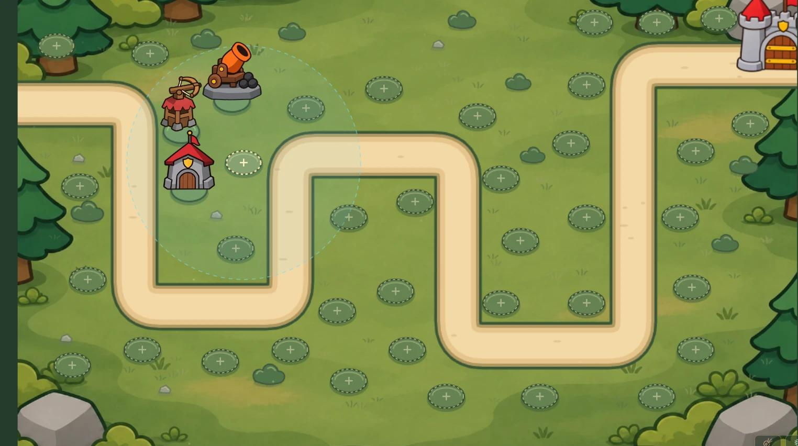

# Эльдерхольм — Последний рубеж

Откройте `index.html` в современном браузере. Для игры нужен только этот файл: внутри находятся код, стили, мультяшная графика со 168 кадрами анимации и отдельным фоном, вспомогательные векторные детали, звуковые эффекты и музыка. Интернет и установка не требуются.

## Как играть

1. Выберите постройку внизу и нажмите на свободную площадку с «+».
2. Нажмите «Начать волну». Строить и улучшать постройки можно и между волнами, и во время боя.
3. После победы выберите направление развития: гвардия, пламя, лёд, буря или экономика.
4. Чтобы продать здание между волнами, нажмите на него и выберите «Продать» вверху панели. Возвращается до 62% затрат на постройку, улучшения и зачарование: повреждения уменьшают возврат.
5. Нажмите на готовую башню: Доступно восемь уровней: II открывает одну из двух специализаций, а IV, VI и VIII добавляют её особые эффекты. Цена следующих улучшений растёт. Изученная школа магии позволяет купить стихийное зачарование.
6. Используйте метеор (55 золотых) и стужу (40 золотых). Берегите ворота: обычный враг снимает 1 прочность, промежуточный босс — 5. Финального Короля Пепла нужно победить на 30-й волне.

На карте 40 площадок для строительства. В кампании 30 волн с растущим здоровьем и численностью врагов; босс появляется каждые пять волн (всего шесть). Рядом с ускорением есть переключатель ∞: после победы игра автоматически продолжает волны и повторяет последний выбранный бонус, в том числе после 30-й волны. Первый бонус выберите вручную. На 7-м ранге выбранного направления выдаётся золото без роста ранга. Снимите ∞, чтобы вернуться к ручному запуску волн. Разные враги обладают бронёй, лечением, полётом и особыми умениями. Летунов не поражают мортиры, стражи и наземные ловушки. Для них нужны лучники, ледяные или магические башни.

Огненные, ледяные и грозовые варианты монстров имеют разные уязвимости и сопротивления. Свойства предстоящей волны указаны над кнопкой запуска; нажмите на врага в бою или откройте раздел «Стихии» в атласе. Зачарование можно наносить и менять за золото даже во время волны.

Боссы атакуют и разрушают постройки: красная метка предупреждает об ударе. Повреждённые здания можно платно ремонтировать между волнами — отдельно или общей кнопкой. Разрушенное место освобождается для новой постройки. Исследования королевства доступны до 7-го ранга в каждом направлении; башни можно улучшить до VIII уровня.

На телефоне работают касания, увеличение кнопкой «+», перетаскивание увеличенной карты и масштабирование двумя пальцами. Альбомная ориентация даёт больше места полю.

Клавиши: `1–6` — постройки, `Q` — метеор, `E` — стужа, `Enter` — следующая волна, `Пробел` — пауза, `Esc` — отмена, `H` — справочник, `M` — звук, `F` — полный экран. Все эти действия доступны и кнопками; справочник на телефоне открывается через меню паузы.

Прогресс автоматически сохраняется между волнами, если браузер разрешает локальное хранилище. Закрытие во время боя возвращает к подготовке этой волны. Звук запускается после нажатия кнопки начала игры; его можно выключить сверху. Фоновая музыка играет плейлист из 11 указанных треков по кругу. Все MP3 встроены в HTML: на другой компьютер достаточно перенести только `index.html`. На паузе музыка приостанавливается, после продолжения возобновляется с того же места.

[Каталог спрайтов, кадров и точных запросов](assets/cartoon/CATALOG.md).

Враги шагают/летают, атакуют и падают после гибели. Стражи идут к противнику, постройки проигрывают кадры выстрела или срабатывания. Перед наградой и победой есть короткая пауза, чтобы закончилась анимация смерти.

Атлас с крупными анимированными спрайтами открывается кнопкой книги сверху, а на телефоне — через меню паузы → «Атлас королевства». В атласе есть переключатели «Движение / Атака / Смерть».

## Исходники и проверка

`index.html` полностью автономен. Исходные файлы для разработки:

- `engine.js` — боевая логика;
- `assets/audio/` — MP3 плейлиста фоновой музыки;
- `sprites.js` — вспомогательные векторные детали;
- `assets/cartoon/` — текущие мультяшные оригиналы, промпты, атласы и упаковщик;
- `animation.js` — выбор и отрисовка кадров анимаций;
- `cartoon-data.js` — встроенные WebP и описания анимаций;
- `ui.js` и `shell.html` — управление, отрисовка и интерфейс;
- `build.py` — сборка исходников в один HTML;
- `qa/` — проверки механик и браузерные сценарии;
- `PLAN.md` — главный план выполнения.

Сборка: `python3 build.py` (для самой игры ничего устанавливать не нужно). Проверка боевой логики: `node qa/engine-test.cjs`; симуляция кампании: `node qa/campaign30.cjs`; анимаций: `node qa/animation-frames.cjs`. Для повторной упаковки графики: `python3 build.py --repack-art` (нужны Pillow и FFmpeg).

## Сборка для сайта и rich

Команда `python3 build.py --web` собирает отдельную папку `site/`:

```text
site/
  index.html
  assets/
    images/  — картинки WebP и атласы анимаций
    audio/   — фоновая музыка MP3
```

HTML содержит код, стили и небольшие векторные детали; большие картинки и музыка загружаются отдельными файлами. Имена ресурсов содержат хеш содержимого, поэтому при изменении файла меняется его адрес. Автономный `index.html` в корне эта команда не перезаписывает.

Для деплоя перенесите **всё содержимое `site/`**, сохранив структуру каталогов, в каталог сайта на rich. Пути относительные: игра работает как в корне сайта, так и в подпапке, например `/games/td/` (адрес каталога должен заканчиваться `/`). Node.js и Python на сервере не нужны — достаточно статической раздачи файлов.

Для локальной проверки: `python3 -m http.server 8774 --directory site`, затем откройте `http://localhost:8774/`. После изменения исходников повторите `python3 build.py --web`.
